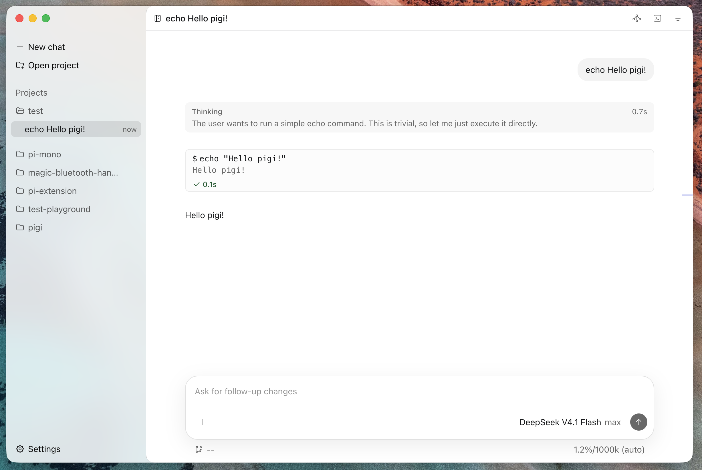
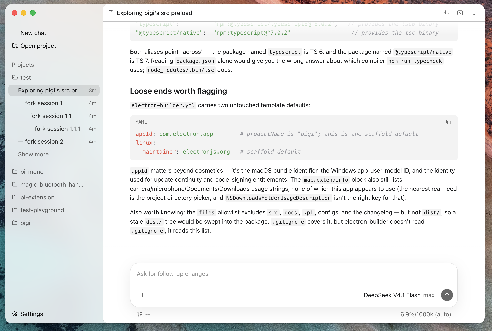
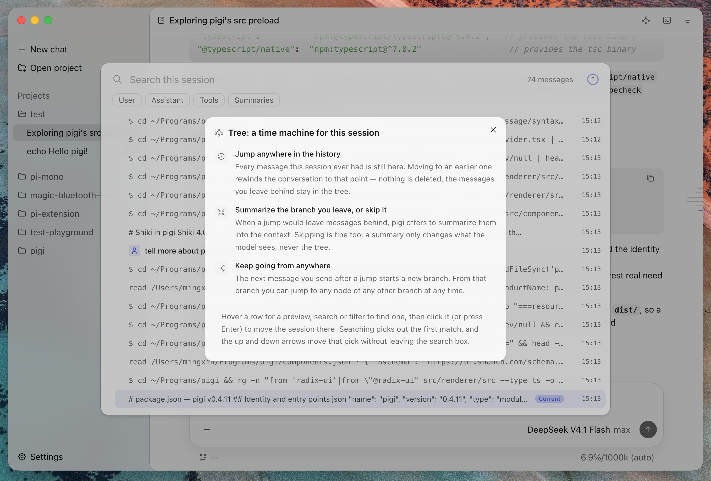
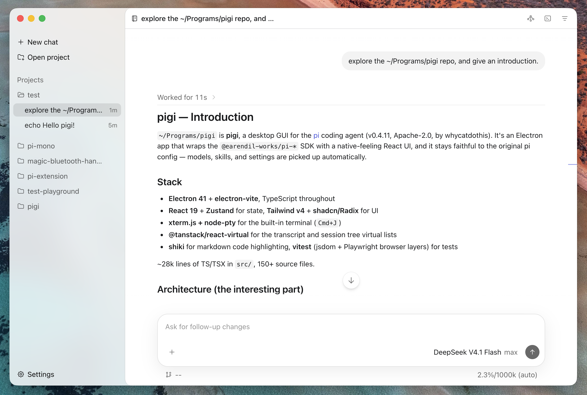
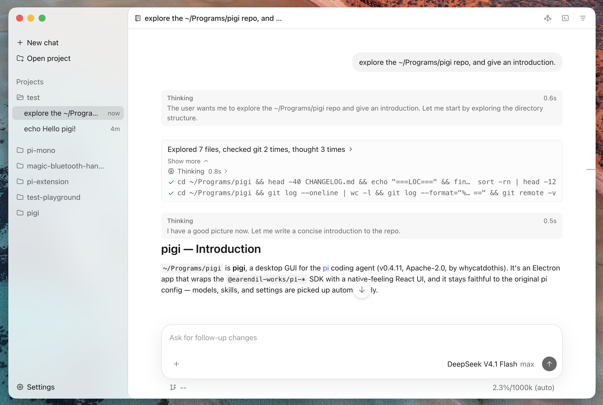
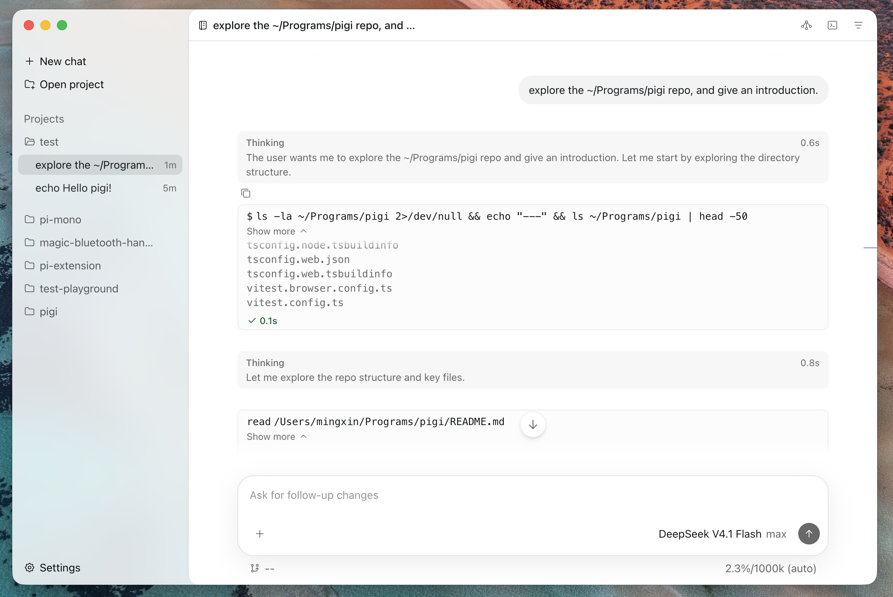
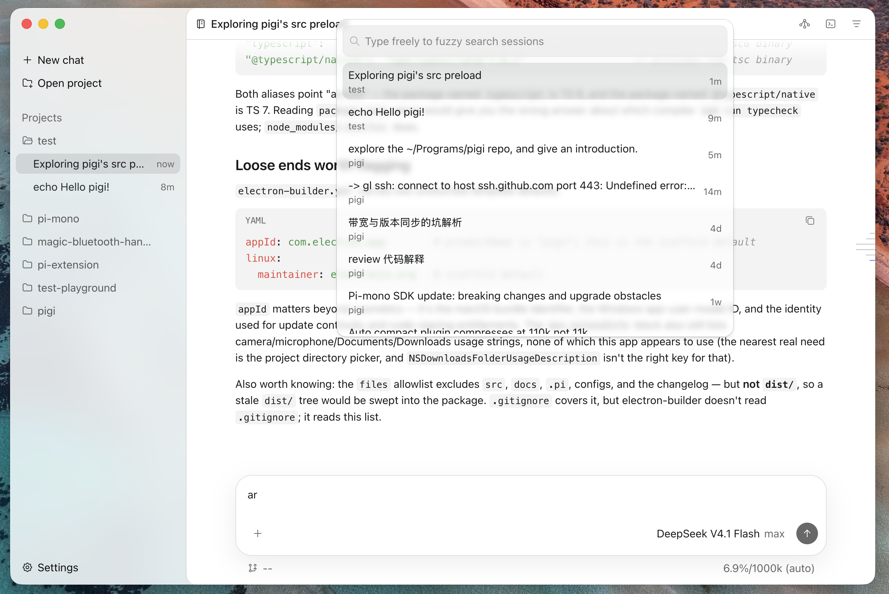
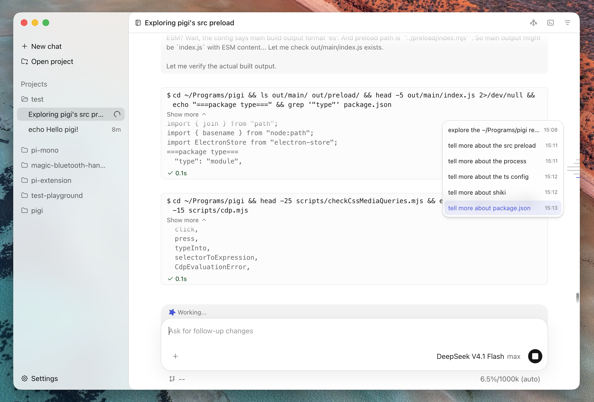
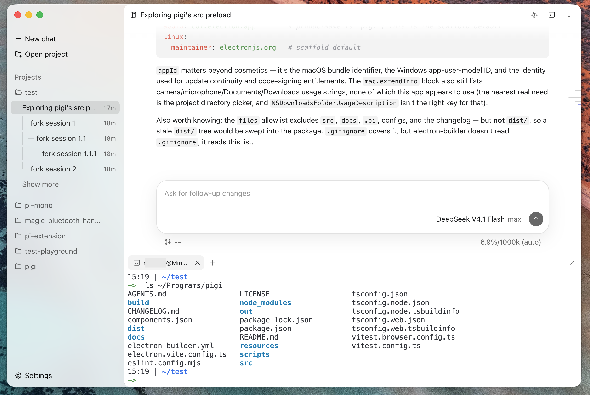

<p align="center">
  
</p>

<p align="center">
  
  
</p>

<h1 align="center">pigi</h1>

<p align="center">
  <strong>A sleek desktop GUI for <a href="https://pi.dev">pi</a></strong>
</p>

---

## Features

- Clean, native UI that stays out of your way
- Faithful to the original pi experience
- Respects your pi config — picks up models, skills, and settings automatically
- Built with performance in mind, no compromises



### Highlights

#### Instant history

Past sessions open instantly, even long ones.

#### Fork

Branch a new session from any user message. Forks stay nested under their original session in the sidebar.



#### Session tree

Browse and jump between branches of a session (`/tree` or the toolbar).



#### View modes

Switch how the transcript renders tool activity.

**Minimal** — Codex-style: working timer, tool cards, final summary.



**Compact** — collapses consecutive read-only tool calls into one group.



**Show All** — every tool call as its own block, like the native pi log.



#### Session search

`Ctrl+R` fuzzy-searches across all sessions.



#### Chat minimap

Overview of your messages for quick navigation in long chats.



#### Built-in terminal

Toggle with `Cmd+J`.



## Install

Download the latest build from [Releases](https://github.com/whycatdothis/pigi/releases).

## Develop

```bash
npm install
npm run dev
```

Build for distribution:

```bash
npm run build:mac
```

## License

[Apache 2.0](./LICENSE)
