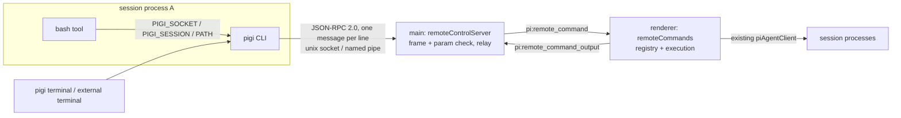

# pigi CLI

Status: phases 1–3 implemented (§14); the PATH install (phase 4) is macOS
only. This document is the design reference. See `docs/architecture.md` for the
process model it builds on and `docs/sessionTree.md` for the fork lineage it
extends.

## 1. Goal

Expose pigi's capabilities through a `pigi` command so agents (and people) can
drive the running app from a shell. The first capability is **subagents**: an
agent in session A runs `pigi subagent "<task>"`, pigi starts a fresh session
linked to A, shows it in the sidebar under A, and prints the subagent's final
reply back to A's bash tool. The typical use is an independent reviewer whose
findings A then triages and fixes in its own context.

Later capabilities (open a file, switch tab, jump to a session) are new commands
on the same transport; the CLI shape does not change.

## 2. Non-goals

- No TCP/HTTP endpoint, no MCP server.
- No token auth or per-caller permission model (§9).
- No nested subagents: `subagent.run` refuses a subagent as the parent
  (`INVALID_PARAMS`, exit 2), so one level is all an agent can spawn.
- No new setting for a default subagent model.
- No single-instance lock in this work (§8); `docs/todo.md` keeps that item.
- AppImage and snap get no PATH install (§11).

## 3. Architecture



**Commands execute in the renderer; main only relays.** After the port
handshake main is not in the session data path (`piAgentBridge.ts`): the
renderer talks to each session process over its own MessagePorts and owns the
UI state. Driving sessions from main would add a second control path and let
the renderer's view drift, and UI commands can only run in the renderer anyway.
So the CLI is a remote control for the UI: anything the user can do there, a
command can do, through the same `piAgentClient` functions.

Cost: a renderer must exist. On macOS the app outlives its window; a request
that arrives with no window reopens it first, as `code` does. Requests wait
(up to 30s) until the renderer sends `pi:remote_control_ready`. Main answers
`system.hello` itself, so the handshake needs no window.

### Main-process load

Main does async socket I/O and parses small JSON envelopes, microseconds per
request. Streaming never crosses main: `session.wait` answers once when the
agent ends. Guards, because a blocked main stalls window dragging, menus and
every renderer IPC:

- A request line over 1 MB closes the connection.
- The renderer serializes each result to a string; main writes it to the socket
  as-is and never parses or re-serializes results.
- No synchronous file I/O in command handling.

If a bulk command (transcript export) ever needs more, the server moves into a
utility process with a MessagePort to the renderer, the same shape as session
and terminal processes. The socket protocol does not change, so clients do not
notice.

## 4. Components

| Part              | Where                                                                                   | What                                                                                                                                                                                 |
| ----------------- | --------------------------------------------------------------------------------------- | ------------------------------------------------------------------------------------------------------------------------------------------------------------------------------------ |
| Public contract   | `src/shared/remoteCommandContract.ts` (new)                                             | Protocol version, method names, param/result types, param parsers (hand-written, like `parsePigiSettingsChange`), error codes. Separate from `ipcContract.ts`, which stays internal. |
| Relay channels    | `src/shared/ipcContract.ts`                                                             | `pi:remote_command`, `pi:remote_command_cancel`, `pi:remote_command_output`, `pi:remote_control_ready`                                                                               |
| Socket server     | `src/main/remoteControl/remoteControlServer.ts` (new)                                   | `net.createServer`, framing, envelope validation, request-id correlation, cancel-on-disconnect                                                                                       |
| Command execution | `src/renderer/src/services/remoteCommands.ts` (new)                                     | Registry; each method calls existing `piAgentClient` functions; installed by `App`                                                                                                   |
| Env injection     | `createPiAgentProcess.ts`, `terminalManager.ts`, `piAgent.ts`                           | §5                                                                                                                                                                                   |
| CLI               | `src/cli/pigi.ts`, `src/cli/cliArguments.ts` (new), `cli` entry of the main build       | Arg parsing and output formatting derived from the contract; only `node:net`                                                                                                         |
| Launcher          | `resources/bin/pigi`, `resources/bin/pigi.cmd`                                          | §11                                                                                                                                                                                  |
| PATH install      | `src/main/ipc/cliInstall.ts`, Settings → Command line, app menu                         | §11                                                                                                                                                                                  |
| Parent notice     | `src/renderer/src/lib/subagentNotices.ts`, `remoteCommands.ts`                          | §10                                                                                                                                                                                  |
| Skill             | `resources/skills/pigi-cli`, injected with `resourceLoaderOptions.additionalSkillPaths` | §12                                                                                                                                                                                  |

## 5. Caller context

Precedent: `VSCODE_IPC_HOOK_CLI`, `$TMUX`/`$TMUX_PANE`, `KITTY_LISTEN_ON`/
`KITTY_WINDOW_ID`, `WEZTERM_PANE` — a socket plus an env var naming the caller.

- **Every session and terminal process**, at fork: `PIGI_SOCKET=<socket path>`
  and `resources/bin` prepended to `PATH`.
- **Session process**, after `createSession`/`resumeSession` succeeds:
  `process.env.PIGI_SESSION = <session file>`. pi's bash tool spreads
  `process.env` at every spawn (`getShellEnv()`), so each command inherits it.
  It has to be set after the claim, not at fork: pooled processes are warmed
  before they know their session.
- **Terminal**: no `PIGI_SESSION`; terminals belong to a project, not a session.
  From a terminal, pass `--parent` explicitly.

## 6. Protocol and compatibility

### Transport

JSON-RPC 2.0, one message per line. Methods are namespaced and each is one CLI
command: `pigi session create` is `session.create`, `pigi ping` is
`system.hello`, `pigi subagent` is `subagent.run`. The renderer serializes each
answer into a finished line; `subagent.run` also sends one notification,
`subagent.started`, with the child's path, model and level before it runs.

### What is a contract

| Contract                                         | Not a contract            |
| ------------------------------------------------ | ------------------------- |
| Transport and envelope                           | Human-readable CLI output |
| Method names, params, result fields              | Error message text        |
| Error codes (number + string code)               |                           |
| CLI commands, flags, `--json` output, exit codes |                           |
| Env var names (`PIGI_SOCKET`, `PIGI_SESSION`)    |                           |
| The `pigi.subagent` session entry (§10)          |                           |

### Evolution rules

1. **Additive only.** New params are optional with a default. Results gain
   fields; existing fields never disappear or change meaning.
2. **Strict server, tolerant client.** An unknown param is rejected with
   `UNSUPPORTED_PARAM` naming it; silently ignoring it would let a newer CLI's
   flag do nothing against an older app. Clients ignore unknown result fields
   and unknown notifications.
3. **Breaking change = new method name.** The old method stays for several
   releases.
4. **Handshake.** `system.hello` returns `{ protocolVersion, appVersion,
methods }`. The CLI calls it first and reports "pigi is too old"
   on a major mismatch or a missing method. Skew is real: an auto-update
   replaces the bundle on disk while the old instance keeps running, so the old
   instance's sessions run the new CLI against the old server.
5. **One source.** The contract module drives both the CLI parser and the server
   validator.
6. **Snapshot test.** The method/param surface is serialized to a committed
   snapshot; removing or renaming anything fails the test until the snapshot is
   updated on purpose.

### Exit codes

`0` success · `1` the request failed, including the session erroring or being
aborted and pigi closing the connection mid-request · `2` usage error · `3` pigi
could not be reached, so nothing ran · `4` still running: `session wait
--timeout` ran out (`--timeout 0` polls without waiting), or the window did not
come back after a reload (§13).

stdout carries only the result (what an agent reads); progress and the child
session path go to stderr. `--json` gives the structured result on stdout.

## 7. Commands (MVP)

```
pigi                                         help; opens the app once installed (§11)
pigi ping                                    → system.hello
pigi session list [--cwd <dir> | --all] [--running] [--subagent] [--parent <session>]
                                             → id, running/subagent marks, title per row
pigi session create [--parent <session> | --parent-self] [--cwd <dir>]
                    [--model <provider/id>] [--thinking <level>]
                                             → new session path on stdout
pigi session prompt <session> "<text>"       returns once the run has started
pigi session wait <session> [--timeout <s>] [--stop]
                                             → final assistant reply on stdout
pigi session status <session>                running, message count, latest tool call and text
pigi session abort <session>                 stop a running session
pigi subagent "<task>" [--model <provider/id>] [--thinking <level>]
                       [--notify | --detach | --timeout <s>]
                       [--parent <session>]  = create linked to $PIGI_SESSION + prompt + wait
```

- `<session>` is a session file, an id, or an id prefix. Ids are UUIDv7, whose
  first 13 characters are the creation time in milliseconds, so `session list`
  prints each id cut to the shortest unique prefix of at least 13 characters.
  An ambiguous prefix is a usage error listing the matches; nothing is picked.
- `-` as the text or task reads it from stdin; relative paths resolve against
  the caller's working directory.
- `subagent` prints the child's id and path on stderr as it starts, also with
  `--json`, so a caller can always come back to it with `session wait`.
- `subagent --notify` returns as soon as the child has started, and the parent
  session is told once it finishes (§10). It implies `--detach`: there is
  nothing left for the call to wait for. It is the way a caller should run a
  subagent: it ends its turn instead of holding a bash call open for minutes,
  and the notice starts the next turn with the child's outcome in hand.
- `subagent --timeout` and `session wait --timeout --stop` abort the session
  when the time runs out and fail with its partial reply. `--stop` also aborts
  it when the wait is cancelled, as a blocking `subagent` does. `--timeout`
  needs a wait, so it goes with neither `--notify` nor `--detach`.
- `prompt` and `wait` attach to a listed session the window has not opened
  (after a reload, say), as selecting it would, without selecting it.

- Background-created sessions **never change the selected session**; a subagent
  must not pull the user out of A.
- `subagent` uses A's cwd.
- `--model` splits at the first `/`: provider before it, the rest is the model
  id (OpenRouter ids contain `/`). An unknown model fails with near matches
  listed; nothing is guessed.

### Model and thinking level

Default: inherit A's **current** model and thinking level. The renderer reads
them from the store and passes them explicitly; a new session would otherwise
start from the global default, which need not match A.

They are passed **at creation**, not set afterwards. `AgentSession.setModel()`
calls `setDefaultModelAndProvider` and `setThinkingLevel()` calls
`setDefaultThinkingLevel`, so a reviewer on another model would change the
user's global default. `createAgentSessionFromServices({ model, thinkingLevel })`
does not persist defaults and clamps the level with pi-ai's
`clampThinkingLevel` (nearest supported, upward first, then downward — the same
semantics as `clampThinkingLevelTo`). So `create_session` gains optional `model`
and `thinkingLevel`, threaded through `createRuntimeFactory`.

A clamp is reported: stderr notes it, and `--json` carries
`"thinkingLevel": { "requested": "max", "effective": "high" }`.

## 8. Socket location and instances

- Production: `<userData>/pigi.sock`; dev: `<userData>/pigi-dev.sock`. Windows:
  `\\.\pipe\pigi-<user>` / `\\.\pipe\pigi-<user>-dev`. A unix path over 103
  bytes (macOS `sockaddr_un`) is not served; the server logs it.
- Outside pigi (no `PIGI_SOCKET`), the CLI connects to the production socket.
- On `EADDRINUSE`, connect to it: refused means a stale file, so unlink and
  listen; accepted means another instance owns it, so this instance serves no
  CLI and logs why.
- No single-instance lock here. Dev and production use different sockets, so
  running both works; a lock would stop the dev build from starting while the
  production app runs, since both share `userData`. Two instances of the same
  build (`open -n`, a double launch on Linux) share one socket: the second
  serves no CLI, and its sessions' `pigi` calls reach the first, which does
  not know their sessions. Not handled; the single-instance item in
  `docs/todo.md` covers it.

## 9. Security

The threat model is the industry one: same-user, unsandboxed processes are
trusted (VS Code's CLI socket has no auth either). What is handled:

- **Browsers**: no TCP port. A page can reach `localhost` (CSRF, DNS rebinding,
  unchecked WebSocket origin — e.g. CVE-2025-52882 in Claude Code's IDE
  extensions) but cannot open a unix socket or named pipe.
- **Other users**: socket in the per-user `userData` directory, mode `0600`, so
  it cannot be reached or pre-created by someone else. The default ACL of a
  Node named pipe on Windows is still unverified (Windows is not released).
- **Malformed input**: main parses every request strictly and answers errors
  with a JSON-RPC error; it must never throw out of the handler.

Documented, not handled:

- Do not pass `PIGI_SOCKET` into a sandbox or container; the socket would be a
  way out (the VS Code dev container `VSCODE_IPC_HOOK_CLI` issue).
- A subagent session does not inherit confirmation extensions loaded in A (for
  example a permission gate).
- macOS privacy grants belong to the app: a caller can reach what pigi was
  granted (Documents, Downloads).

pi's bash tool is already unrestricted, so the CLI adds little an injected agent
could not do without it.

## 10. Subagent sessions

### Marking

On creation through the CLI the child session gets one pi `custom` entry:

```json
{
  "type": "custom",
  "customType": "pigi.subagent",
  "data": { "version": 1, "sessionId": "<own id>" }
}
```

`custom` entries never reach the LLM context. The link to A is the existing
`parentSession` header.

**Rule**: a session is a subagent when it has this entry, the entry comes before
the first `message`, and `data.sessionId` equals the header `id`. Forking a
subagent copies the entry along the path, but the fork has a new id, so it is
an ordinary fork.

Rejected: a header field (pi owns the header; `SessionManager.create` only takes
`parentSession`), a pigi index file (drifts from the session files), a name
prefix (visible and renameable).

### Listing

`SessionManager.list` does not return custom entries. `sessionWorker` reads them
only for files with `parentSessionPath`, and only up to the first `message`, and
sets `PiSessionInfo.isSubagent`. pi writes a session file only after its first
assistant message, so there is no half-written case to handle.

### Sidebar

```
● Implement login                         2m
  ├ 3 subagents, 1 running               ← group row, collapsed, first child
  ├ Login (fork)                          5m
  └ Other approach (fork)                 1h
```

1. A parent's subagents form one group row, always its **first** child,
   regardless of activity order. Inside the group, newest first. Forks keep
   today's ordering.
2. The group is **collapsed by default**. The "show more" limit counts five
   root sessions; their forks and subagents come along without counting.
   Expansion is kept per parent path in localStorage, across restarts, not as
   a setting. A new running subagent does not expand it.
3. The group row shows the count, how many run and latest activity, but no
   spinner (the label says it) and no unread dot: subagents finish unattended all the time. Expanded, each
   subagent row shows its own.
4. Selecting a session hidden in a collapsed group (CLI path, navigation
   history) expands that group, as the "show more" auto-expand does today.
5. No icon on subagent rows or the group row; connectors match forks.
6. Any session with forks or subagents has a chevron in its row's left gutter
   that hides them all, group row included; expanded by default, and kept
   across restarts like the groups. Selecting a session under a collapsed one
   expands it.
7. A fork of a subagent nests under that subagent. A subagent has no subagents
   of its own (§2); a fork of one is an ordinary session and may.

### Notifying the parent

`subagent --notify` is what a caller is told to use, so its run has to end
somewhere the caller can see it.

- The renderer watches the child it started; when the child is idle (or its
  process is gone) it writes one line into the parent session: which child,
  `finished` or `failed: <reason>`, and `pigi session wait <child id>` for the
  reply — or says the child produced nothing, when it died before its first
  message, in which case that command has nothing to read. The reply is never
  inlined — it is the reason the child exists, and it can be as long as the
  model likes.
- The line is a custom message (`pigi.notice`), not a prompt: the parent's
  transcript shows a notice card rather than a turn the user appears to have
  typed, and ↑-recall in its composer does not offer the notice as a past
  prompt. The agent reads it as message text like any other, which is why the
  text names pigi.
- The parent may have stopped meanwhile (its process is pruned when idle): it is
  resumed first, and the notice starts a fresh turn. Nothing is lost by the
  parent ending its turn, which is the point.
- A parent in the middle of a turn is not interrupted: the notice is queued as a
  follow-up and gets a turn of its own when the current one ends.
- The notice is renderer state, but the child outlives the renderer (a reload, a
  crash, a closed window). Pending notices are therefore kept in localStorage
  and re-armed by the next renderer: it resumes the child, waits for it to be
  idle and then notifies. A notice is written once the child's run has started,
  so a reload in the moment between creating the child and that start fails the
  CLI call (exit 1) and leaves no notice: the child runs on and
  `pigi session wait` still reads it.
- A pending notice gets one delivery attempt. A parent session that no longer
  exists, or a message that cannot be written, is logged and the notice
  dropped: retrying a notice forever would hide the failure instead of
  reporting it. The child is still in `pigi session list --subagent` either
  way.
- Delivering a notice is the only thing in the CLI surface that starts a turn in
  a session the caller did not prompt.

## 11. Installing `pigi` on PATH

Not needed inside pigi: sessions and the terminal get `resources/bin` on `PATH`
(§5). Installing serves external terminals only.

### Launcher (`resources/bin/pigi`)

1. Resolve its own symlink chain with a `readlink` loop to find the bundle, then
   the Electron binary and `cli.js`, as VS Code's `bin/code` does.
2. Run `cli.js` (inside `app.asar`, which Electron reads in Node mode too) under
   `ELECTRON_RUN_AS_NODE=1`, so users need no Node install. Bare `pigi` prints
   help today; opening the app (`open -b <bundle id>` on macOS) comes with the
   install.
3. The dev build offers no install; it relies on `PATH` injection only.

### macOS

Done (`src/main/ipc/cliInstall.ts`). Menu item **Install 'pigi' Command in
PATH** and its uninstall counterpart, and the same in Settings → Command line:

- Symlink `/usr/local/bin/pigi` → `pigi.app/Contents/Resources/bin/pigi`.
  `/usr/local/bin` is in `/etc/paths`, so no shell rc edits. When it is not
  writable or missing (common on fresh Apple Silicon Macs), escalate with
  `osascript … with administrator privileges`; a cancelled password prompt is
  reported, not retried.
- Not `~/.local/bin`: it is not on the default macOS `PATH`, which would mean
  editing zsh/bash/fish rc files.
- Refuse to install from a build macOS may move: a dev build (its launcher
  points at `out/`) and a bundle under App Translocation (launched from
  Downloads or the mounted DMG) would both install a link that soon breaks. The
  Settings row says which case it is.
- An existing `/usr/local/bin/pigi` is "ours" when it points into a bundle's
  `app.asar.unpacked/resources/bin`, so a link left by an older copy of the app
  (before it moved) reads as broken and is replaced without asking. Anything
  else at the path — another program's file, or a link elsewhere — is replaced
  only after asking, and uninstalling never touches it.
- Auto-update replaces the bundle in place, so the link stays valid and the CLI
  always matches the installed app.

Settings shows the state: installed / broken link / taken by another program /
not installed. Nothing installs without the user asking.

### Windows and Linux

Not implemented.

- Windows: the NSIS installer (`nsis.include`) adds `<install>\resources\bin` to
  the **user** `PATH` (HKCU) and the uninstaller removes it. Never `setx`: it
  truncates `PATH` at 1024 characters. A new terminal is needed to see it.
- Linux deb: electron-builder's default after-install script appears to link
  `/usr/bin/pigi` to the GUI binary (verify). Override `afterInstall` to link
  the launcher instead. AppImage (path changes per version) and snap
  (confinement): unsupported, documented.

### Opening the app

The launcher only runs the CLI; bare `pigi` prints help. Opening the app from
it (`open -b <bundle id>` on macOS) bakes the id in, so it waits for the switch
to `pink.pigi` (`docs/todo.md`). The link itself does not depend on that.

## 12. Agent discoverability

A bundled `pigi-cli` skill, loaded on demand, rather than a line in
`PIGI_SYSTEM_PROMPT` that every session pays for. It presents `pigi` as the
general way to operate the app and sends agents to `pigi --help` for the
current command set, which grows. Beyond that it describes today's commands
and their mechanics only (returning early, `--notify`, blocking, abort, no
nesting, exit codes) and leaves flags to `pigi <command> --help`, so it does not
drift from the contract. It does make one recommendation — start a subagent with
`--notify` and end the turn — because that is the mechanics an agent gets wrong
otherwise: holding a bash call open for minutes, or polling `session status` in
a loop. Workflows built on it, such as review-and-fix, belong in the user's own
skills, not here.

## 13. Failure behavior

| Case                                 | Behavior                                                                                                                                                                                                                                                                                                                                                                                                           |
| ------------------------------------ | ------------------------------------------------------------------------------------------------------------------------------------------------------------------------------------------------------------------------------------------------------------------------------------------------------------------------------------------------------------------------------------------------------------------ |
| A aborts the bash call (CLI killed)  | Socket closes → main tells the renderer → the child session is aborted, unless `--detach` or `--notify`                                                                                                                                                                                                                                                                                                            |
| Renderer reloads mid-request         | Pending requests fail with `WINDOW_RELOADED`; sessions keep running. A blocking `subagent` or `session wait` waits again on the same connection, for as many reloads as come, keeping its timeout and abort-on-cancel (`--stop`). A child still in its first turn has no file yet; lookup falls back to main's running processes. A window that does not come back: exit 4, `pigi session wait <path>` to continue |
| Renderer crashes mid-request         | Same as a reload                                                                                                                                                                                                                                                                                                                                                                                                   |
| No window (macOS)                    | Main reopens the window, then relays                                                                                                                                                                                                                                                                                                                                                                               |
| Created session never prompted       | Idle, it can be closed when other sessions finish (the pool keeps three idle); prompt it right away                                                                                                                                                                                                                                                                                                                |
| Parent stopped when the child ends   | Its process is resumed and the notice is written into it (§10), which starts a new turn: ending a turn costs nothing                                                                                                                                                                                                                                                                                               |
| Parent is running when it ends       | The notice is queued as a follow-up and starts a turn once the current one ends; the parent is never interrupted                                                                                                                                                                                                                                                                                                   |
| A notice cannot be written           | One attempt: it is logged and dropped rather than retried, so a deduplication bug cannot loop; the child stays in `pigi session list --subagent`                                                                                                                                                                                                                                                                   |
| Renderer reloaded while a child runs | The pending notice is in localStorage; the next renderer resumes the child and delivers when it is idle                                                                                                                                                                                                                                                                                                            |
| pigi quits while a child runs        | The child dies with the app; the notice survives and the next start delivers it, with whatever the child left behind                                                                                                                                                                                                                                                                                               |
| pigi not running                     | Exit code 3 with a clear message                                                                                                                                                                                                                                                                                                                                                                                   |

## 14. Phases

1. **Transport** (done). Socket server, relay, contract, `system.hello`, CLI
   skeleton, env injection, `ping` and `session list`. Contract snapshot test.
2. **Subagent** (done). `session create/prompt/wait` and `subagent`; `model`
   and `thinkingLevel` on `create_session`; no selection change; abort on
   disconnect; `pigi.subagent` entry, `isSubagent`, sidebar group.
3. **Agent use** (done). Bundled skill, CHANGELOG.
4. **PATH install** (macOS done, §11); Windows and Linux deb to go.
5. **Notify** (done). `subagent --notify`, the parent notice (§10), the skill
   recommending it.

Later: UI commands (`ui.openFile`, tab switching, jump to session); a structured
A → child link (a `custom` entry in A pointing at the child, rendered as a link
on the bash card).

## 15. Tests

- Unit: contract parsers, CLI argument parsing, the contract surface snapshot,
  `subagentNotices.test.ts` (the notice text and its storage), `cliInstall.test.ts`
  (installed / broken / another program's link).
- `sessionLineage.test.ts`: group placement first, collapsed row count, a fork
  of a subagent stays a fork, auto-expand on a hidden selection.
- `subagentMarker.test.ts`: marker detection, including the fork-of-subagent case.
- End to end with the `pigi-debug` skill: run `pigi subagent` from a real
  session in the dev build and check the sidebar and the returned reply; run
  `pigi subagent --notify` and check that the parent gets its notice once the
  child is idle.
