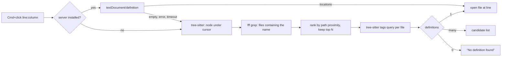

# Go to Definition in the Files Tab

Status: plan, implementation in progress on `feat/go-to-definition`.

## 1. Goal

In the Files tab source view, Cmd/Ctrl+click an identifier to jump to where it
is defined. One definition opens directly; several open a candidate list.

Two tiers:

1. **Language server**, when one for the file's language is already installed
   on the user's machine. Type-aware, handles locals, imports and overloads.
2. **Search-based fallback** (GitHub's "search-based code navigation"):
   tree-sitter plus fff, bundled with pigi, so navigation works with nothing
   installed. Used when no server is installed, it fails, it is too slow, or
   it finds nothing.

## 2. Non-goals

- pigi does not install, bundle or configure language servers. It uses what
  is on `PATH` (the login shell's) or in Mason's bin directory, with default
  settings. Servers bundled inside editor extensions are not used: they need
  the editor's runtime, configuration or license (Pylance).
- No persistent symbol index in the fallback. Files change constantly (the agent edits them, the
  user switches branches), and keeping an index valid needs a recursive
  watcher plus a startup rescan. Every lookup reads the files as they are on
  disk now.
- Fallback only: no type resolution (`obj.save()` lists every `save`
  definition) and no local scope (tags queries capture module-level and member
  definitions, not locals or parameters).
- No string-keyed references (Vuex `dispatch('cart/addItem')`, `mapActions`).
- No navigation from the Git diff view, from Markdown preview, or in files
  outside the project (opened by absolute path from chat).

## 3. How a lookup works

### 3.1 Language server

| Language                | Servers tried, in order                                                                                                                            |
| ----------------------- | -------------------------------------------------------------------------------------------------------------------------------------------------- |
| TypeScript / JavaScript | `typescript-language-server --stdio`, `vtsls --stdio`                                                                                              |
| Python                  | `basedpyright-langserver --stdio`, `pyright-langserver --stdio`, `pylsp`, `jedi-language-server`                                                   |
| Go                      | `gopls`                                                                                                                                            |
| Rust                    | `rust-analyzer`                                                                                                                                    |
| Java                    | `jdtls -data <pigi cache dir>`                                                                                                                     |
| Perl                    | `perlnavigator --stdio`                                                                                                                            |
| Vue                     | none: the Vue language server (2.x and later) answers script positions only through a paired TypeScript server plugin, so `.vue` uses the fallback |

- **Detection.** The first candidate found on `PATH` or in
  `~/.local/share/nvim/mason/bin`. The utility process inherits main's
  environment after the login shell's `PATH` is applied.
- **Lifecycle.** One server per (command, project), started on the first
  lookup in that project and shut down after 10 idle minutes or when the
  utility process exits. `initialize` sends our `processId`, so servers exit
  if pigi is killed. A server that fails to start or initialize is not retried
  until the utility process restarts.
- **Request.** `didOpen` the file with its current disk content (`didChange`
  with a new version on later lookups), then `textDocument/definition`.
  Positions are UTF-16 code units, the LSP default, which is also what the DOM
  caret offset gives.
- **Budget.** The first lookup includes server start-up, which can take
  seconds (rust-analyzer and jdtls index the project). If the server has not
  answered within 3 s, that lookup uses the fallback and the server keeps
  starting for the next click. Empty results and errors also fall back.
- **Results** may point outside the project (standard library, `node_modules`
  declarations); they open by absolute path.
- **Staleness.** Servers that only learn about unopened files through client
  file-watch notifications (gopls) can answer from old content after the agent
  edits a file. The idle shutdown bounds it; file-watch forwarding is not
  planned.

### 3.2 Search-based fallback

1. **Identify.** Parse the current file, take
   `rootNode.descendantForPosition(point)` and accept it only if its node type is
   in that language's identifier allowlist. The exact lists live next to the
   grammar config in code; they must cover reference positions, not only
   declarations (Perl calls are `(function)`, method calls `(method)`, package
   names `(package)`). Clicks on keywords, strings and comments do nothing.
   - Perl qualified names: a `(package)` node (`Foo::Bar->new`, `use Foo::Bar`)
     searches the whole name against `package` definitions. A qualified call
     (`Foo::Bar::baz()`) searches the last segment, `baz`, and ranks first the
     files whose `package` is `Foo::Bar`.
2. **Recall.** `finder.grep(pattern, { mode: 'regex', smartCase: false,
maxMatchesPerFile: 1, pageSize: 1000 })`, following `nextCursor` to the end.
   - Only files are needed, so one match per file is enough.
   - `smartCase: false`: otherwise a lowercase name also matches `Save`, `SAVE`.
   - The pattern uses explicit boundaries, `(?:^|[^\w$])<escaped>(?:[^\w$]|$)`,
     not `\b`: `\b` never matches next to `$`, which breaks `$emit` or `foo$`.
   - No time budget: grep scans files in frecency order, so a budget cut would
     drop files by recency, not by distance, and ranking could only reorder
     what was found. If a full scan is too slow on a large repository (phase 0
     measures it), recall widens from the current directory outwards with
     fff's `dir/ pattern` constraint instead.
   - fff already respects `.gitignore` (root and nested) the same way rg does;
     it also searches non-ignored hidden files, which is what we want
     (`.github/`, `.eslintrc.js`).
   - Files outside the clicked file's language family (§4) are dropped.
3. **Rank and cap.** Same file > same directory > longest common path prefix.
   Parse at most N files (start with 200); a common name like Perl
   `value_type` recalls thousands.
4. **Filter.** Run the language's tags query; keep `@definition.*` captures whose
   `@name` text equals the symbol.
5. **Open.** Reuse `onOpenFile(path, { start: line, end: line })`, which already
   switches to source view, scrolls to and highlights the line.

fff's own `classifyDefinitions` is not used: it skips languages it does not
know (on `~/work/main` it searched 15k of 120k files and found none of the
5540 Perl `sub value_type`), and it does not recognise `const` definitions.

## 4. Languages

| Family                  | Extensions                                                   | Grammar                                                   | wasm                | Tags query source                               |
| ----------------------- | ------------------------------------------------------------ | --------------------------------------------------------- | ------------------- | ----------------------------------------------- |
| TypeScript / JavaScript | `.ts` `.mts` `.cts` `.tsx` `.js` `.mjs` `.cjs` `.jsx` `.vue` | tree-sitter-typescript (ts + tsx), tree-sitter-javascript | 2.3 + 2.4 + 0.65 MB | upstream JS + TS `tags.scm`, plus our additions |
| Python                  | `.py` `.pyi`                                                 | tree-sitter-python                                        | 0.48 MB             | upstream                                        |
| Go                      | `.go`                                                        | tree-sitter-go                                            | 0.24 MB             | upstream                                        |
| Rust                    | `.rs`                                                        | tree-sitter-rust                                          | 1.1 MB              | upstream                                        |
| Java                    | `.java`                                                      | tree-sitter-java                                          | 0.41 MB             | upstream                                        |
| Perl                    | `.pm` `.pl` `.t`                                             | tree-sitter-perl/tree-sitter-perl                         | 4.7 MB              | rgctl (MIT), plus our additions                 |

`.vue` belongs to the TS/JS family for recall; it is additionally parsed with
tree-sitter-vue to find its `<script>` block (§4.1).

Total with `web-tree-sitter.wasm` (0.2 MB): about 12.5 MB, before DMG
compression. Sizes come from each grammar's latest GitHub release or the
`tree-sitter-wasms` package; phase 0 confirms the pinned builds.

The upstream queries are a starting point, not complete. Known gaps to add:

- TS: `type X =`, `enum X`, non-function `const X = …` at module scope.
- JS/TSX: components wrapped in a call (`const X = memo(…)`, `forwardRef`,
  `styled.div`).
- Perl: `use constant NAME =>`, Moose/Moo `has name =>`.

Reference captures (`@reference.*`) are dropped; only definitions are needed.

### 4.1 Vue

tree-sitter-vue only splits the SFC into blocks; `<script>` content is raw
text. Parse it with the grammar its `lang` attribute names (`ts` →
typescript, `tsx` → tsx, none → javascript), restricted to the script block's
range (web-tree-sitter `includedRanges`, confirmed in phase 0), then use that
grammar's query. Template expressions (`{{ total }}`, `@click="save"`) and
component tags (`<user-card>` → `UserCard`) are phase 2.

Use `tree-sitter-grammars/tree-sitter-vue` (maintained; `ikatyang`'s was last
pushed 2024-02). Neither publishes releases, so its wasm is built with
`tree-sitter build --wasm` at a pinned commit; the `tree-sitter-wasms` build
is too old to trust with the current runtime.

### 4.2 Perl evidence

On 496 `.pm` files sampled from `~/work/main` (4.6 MB), web-tree-sitter 0.27.2
with the v2.0.6 wasm (ABI 15) and the rgctl query found 2870 `sub`
definitions against 2884 from `^\s*sub\s+\w+`. The misses were one-line subs
on lines with parse errors (14 of 496 files had an error node). Parse speed
was ~1.6 MB/s, about 6 ms per file, which is why step 3 caps N.

## 5. Where the code goes

- **A utility process**, `codeNavigation`, like the existing workers in
  `src/processes/utility/`. fff `grep` and tree-sitter `parse` are
  synchronous: on `~/work/main` a full grep took 1.6–2.3 s (with
  `projectFileSearch.ts`'s current flags, content index and mmap cache off)
  and 200 parses take ~1.2 s, which in main would freeze every IPC call and
  window event. Language server clients live in the same process.
  - Main starts it on the first lookup, after the login shell's environment
    is applied, and passes `FFF_C_LIB` and the `resources` path through its
    environment (the utility process has no `app`). It restarts on the next
    lookup if it exits.
  - The process owns its own fff finder per project, separate from the
    `@`-search finder in main (a native handle cannot cross processes), with
    the same flags as `projectFileSearch.ts`.
- **Code**:
  - `src/processes/utility/codeNavigation.ts`: entry, request routing.
  - `src/processes/utility/codeNavigation/`: `languages.ts` (per-language
    grammar, query, identifier allowlist, server candidates),
    `treeSitter.ts`, `languageServer.ts`, `searchDefinitions.ts`.
  - `src/main/projects/codeNavigation.ts`: starts the process, matches
    replies to requests.
- **Shared**: the extension → family map in `src/shared/`, so the renderer
  knows which files support navigation without an IPC round trip.
- **IPC**, following `ipcContract.ts`:
  - `PiChannel.FindDefinition = 'pi:find_definition'`, positional arguments
    like `readProjectFile`: `findDefinition(cwd, filePath, line, column)`.
  - Result: `{ success: true; symbol: string; definitions: { filePath; line;
lineContent }[] } | { success: false; error: string }`. `filePath`
    is project-relative, or absolute outside the project.
  - Wiring: `src/shared/ipcContract.ts`, `src/preload/index.ts`,
    `src/preload/index.d.ts`, `src/main/ipc/projectHandlers.ts` (with its
    `isProjectPath` check).
- **Renderer**, `FileViewer` source mode, only for supported extensions and
  files inside the project:
  - While Cmd/Ctrl is held, the pointer over code becomes `cursor: pointer`.
    No underline in phase 1: token bounds would need a lookup per mousemove.
  - The column is the caret offset inside the line's content span
    (`min-w-0 whitespace-pre` in `syntaxHighlightedCode.tsx`), not the
    `[data-source-line]` row, which also holds the gutter number.
  - Candidate list: a popover at the click (`components/ui/popover.tsx` +
    `command.tsx`) showing `filePath:line` and `lineContent`.
- **Assets**: grammar wasm files and our `.scm` queries vendored under
  `resources/treeSitter/` (unpacked by `asarUnpack: resources/**`, resolved
  like `remoteControlServer.ts` resolves `resources/bin`), with a manifest of
  the repository and tag or commit each wasm came from. Grammar npm packages
  carry native install scripts we do not need. Each `.scm` file keeps an
  upstream attribution line.

## 6. Phases

### Phase 0: verify

- [ ] `web-tree-sitter.wasm` stays inside the asar (it comes from
      `node_modules`); confirm `Parser.init` finds it in a packaged build.
- [ ] Every pinned grammar wasm loads with the pinned runtime (ABI range).
      tree-sitter-java's latest release is 2024-12.
- [ ] Column units: DOM caret offset (UTF-16) vs web-tree-sitter
      `Point.column`. Test a line with CJK and emoji.
- [ ] Latency of a full recall on `~/work/main`, with and without fff's content
      index, and the memory the index costs. Decides whether recall needs the
      widening search from §3 step 2.
- [ ] fff constraints (`*.ts pattern`, `dir/ pattern`) combine with
      `mode: 'regex'`, and whether one query can name several extensions.
- [ ] Vue: build the wasm; confirm `includedRanges` (or an equivalent) works.
- [ ] Not tested yet: fff in a non-git directory, `.ignore` files, global
      gitignore.

### Phase 1: definitions in all listed languages

- [ ] Vendored assets and manifest; queries with the gaps from §4 filled.
- [ ] Utility process with the search-based fallback: identify, recall, rank,
      cap, filter.
- [ ] Language server tier: detection, lifecycle, budget, fallback.
- [ ] IPC channel and handler.
- [ ] FileViewer Cmd/Ctrl+click, pointer cursor, candidate popover,
      empty-result feedback.
- [ ] Vue `<script>` blocks.

### Phase 2

- Vue template expressions and component tags.
- Import paths: clicking `'./foo'` opens the file.

## 7. Testing

- One fixture file per language under `src/processes/utility/codeNavigation/fixtures/`, with
  a unit test asserting the definitions its query extracts. This catches a
  grammar upgrade that renames or restructures nodes: a renamed node fails
  query compilation loudly, but a new wrapper node silently breaks patterns
  anchored to a parent, such as upstream Python's
  `(module (expression_statement (assignment …)))`.
- `findDefinition` against a temporary repository: ranking, `.gitignore`, cap,
  `$`-names, Perl qualified names, a click on a keyword or in a comment.
- Language server tier against a small fake server (a Node script speaking
  JSON-RPC on stdio): a normal answer, an empty answer, a timeout, a server
  that exits during `initialize`. None of the real servers is installed on
  the author's machine, so this test is what covers the protocol code.
- Manual: `~/work/main` (Perl, 120k files) for latency, pigi itself for TS/TSX.

## 8. Open questions

- **Back navigation.** A jump without a way back is frustrating when browsing.
  Does the Files tab get a small back/forward history in phase 1, or later?
- **Trigger.** Cmd/Ctrl+click only, or also a context-menu item for discovery?
- **Cap N.** 200 files is a guess; phase 0 measurements set it.
