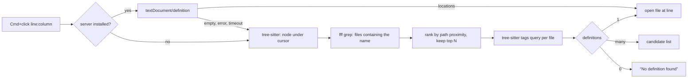

# Go to Definition in the Files Tab

Status: phase 1 implemented on `feat/go-to-definition`; phase 0 results are
recorded in §6.

## 1. Goal

In the Files tab source view, Cmd/Ctrl+click an identifier to jump to where it
is defined. One definition opens directly; several open a candidate list.

Two tiers:

1. **Language server**, when one for the file's language is already installed
   on the user's machine. Type-aware, handles locals, imports and overloads.
2. **Search-based fallback** (GitHub's "search-based code navigation"):
   tree-sitter plus fff, bundled with pigi, so navigation works with nothing
   installed. Used when no server is installed, it fails, it is too slow, or
   it finds nothing.

## 2. Non-goals

- pigi does not install, bundle or configure language servers. It uses what
  is on `PATH` (the login shell's) or in Mason's bin directory, with default
  settings. Servers bundled inside editor extensions are not used: they need
  the editor's runtime, configuration or license (Pylance).
- No persistent symbol index in the fallback. Files change constantly (the agent edits them, the
  user switches branches), and keeping an index valid needs a recursive
  watcher plus a startup rescan. Every lookup reads the files as they are on
  disk now.
- Fallback only: no type resolution (`obj.save()` lists every `save`
  definition) and no local scope (tags queries capture module-level and member
  definitions, not locals or parameters).
- No string-keyed references (Vuex `dispatch('cart/addItem')`, `mapActions`).
- No navigation from the Git diff view, from Markdown preview, or in files
  outside the project (opened by absolute path from chat).

## 3. How a lookup works

### 3.1 Language server

| Language                | Servers tried, in order                                                                                                                                                                                                                                 |
| ----------------------- | ------------------------------------------------------------------------------------------------------------------------------------------------------------------------------------------------------------------------------------------------------- |
| TypeScript / JavaScript | `typescript-language-server --stdio`, `vtsls --stdio`                                                                                                                                                                                                   |
| Python                  | `basedpyright-langserver --stdio`, `pyright-langserver --stdio`, `pylsp`, `jedi-language-server`                                                                                                                                                        |
| Go                      | `gopls`                                                                                                                                                                                                                                                 |
| Rust, Java, Perl        | none: rust-analyzer, jdtls and perlnavigator run project code by default (`build.rs` and proc macros, Gradle and Maven builds, `perl -c` running `BEGIN` blocks), and a click should not run a repository's code; jdtls also cannot read Bazel projects |
| Vue                     | none: the Vue language server (2.x and later) answers script positions only through a paired TypeScript server plugin, so `.vue` uses the fallback                                                                                                      |

- **Detection.** The first candidate found on `PATH` or in
  `~/.local/share/nvim/mason/bin`. The utility process inherits main's
  environment after the login shell's `PATH` is applied.
- **Lifecycle.** One server per (executable, project), started on the first
  lookup in that project and killed when the utility process exits, which it
  does after 10 idle minutes (§5). `initialize` sends our `processId`, so
  servers exit if pigi is killed. A server that fails to start, does not
  answer `initialize` within 60 s, or exits is not retried until the utility
  process restarts.
- **Request.** tree-sitter identifies the clicked symbol first (§3.2 step 1);
  a click off an identifier asks nobody. The clicked file is opened with its
  current disk content (`didChange` if it is already the open one), and
  `textDocument/definition` asks at the identifier's start. Only the last
  looked-up file stays open: an open document is an overlay the server trusts
  over the disk, which the agent keeps changing. Closing it after every lookup
  makes typescript-language-server unload the project and answer the next
  lookup with the import line instead of the definition. Positions are UTF-16
  code units, the LSP default, which is also what the DOM caret offset and
  tree-sitter's columns give. `.jsx` opens as `javascriptreact`, or
  typescript-language-server parses it without JSX.
- **Verified** with typescript-language-server 6.1.0 (TypeScript 5.9) and
  pyright: both find parameters and locals, which the fallback cannot. Two
  limits seen: the first lookup in a freshly started TypeScript server can
  still land on the import line (the project is not loaded yet), and
  typescript-language-server refuses workspaces on TypeScript 6 or 7 (no
  `tsserver.js`, pigi's own repository among them), which then use the
  fallback.
- **Budget.** The first lookup includes server start-up, which can take
  seconds. If the server has not
  answered within 3 s, that lookup uses the fallback and the server keeps
  starting for the next click. Empty results and errors also fall back. A
  started server that runs out of budget three lookups in a row is killed and
  not retried; the next installed candidate is tried instead.
- **Results** may point outside the project (standard library, `node_modules`
  declarations); they open by absolute path.
- **Staleness.** Servers that only learn about unopened files through client
  file-watch notifications (gopls) can answer from old content after the agent
  edits a file. The idle exit bounds it; file-watch forwarding is not
  planned.

### 3.2 Search-based fallback

1. **Identify.** Parse the current file, take
   `rootNode.descendantForPosition(point)` and accept it only if its node type is
   in that language's identifier allowlist. The exact lists live next to the
   grammar config in code; they must cover reference positions, not only
   declarations (Perl calls are `(function)`, method calls `(method)`, package
   names `(package)`). Clicks on keywords, strings and comments do nothing.
   - Perl names: a package (`use Foo::Bar`, `require Foo::Bar`,
     `Foo::Bar->new`) is searched whole against `package` definitions. A
     qualified call (`Foo::Bar::baz()`) searches `baz` and keeps the subs of
     package `Foo::Bar` when there are any. `&foo` and `\&foo` name sub `foo`.
     A sub belongs to the `package Foo { … }` around it, else the last
     `package Foo;` above it.
2. **Recall.** `finder.grep(pattern, { mode: 'regex', smartCase: false,
maxMatchesPerFile: 1, pageSize: 1000 })`, following `nextCursor` to the end.
   - Only files are needed, so one match per file is enough.
   - `smartCase: false`: otherwise a lowercase name also matches `Save`, `SAVE`.
   - The pattern uses explicit boundaries, `(?:^|[^\w$])<escaped>(?:[^\w$]|$)`,
     not `\b`: `\b` never matches next to `$`, which breaks `$emit` or `foo$`.
   - No time budget: grep scans files in frecency order, so a budget cut would
     drop files by recency, not by distance, and ranking could only reorder
     what was found. If a full scan is too slow on a large repository (phase 0
     measures it), recall widens from the current directory outwards with
     fff's `dir/ pattern` constraint instead.
   - fff already respects `.gitignore` (root and nested) the same way rg does;
     it also searches non-ignored hidden files, which is what we want
     (`.github/`, `.eslintrc.js`).
   - Files outside the clicked file's language family (§4) are dropped, and
     files over 1 MB are skipped (`maxFileSize`): generated bundles parse
     slowly and rarely hold the definition.
3. **Rank and cap.** The file itself, then (Perl) the package's own file,
   `Foo/Bar.pm` for `Foo::Bar`, then by directories shared with the file, how
   deep below them, and path length. A common name like Perl `value_type`
   recalls thousands of files, so after 200 parsing goes on only while nothing
   has been found, for at most 3 more seconds.
4. **Filter.** Run the language's tags query; keep `@definition.*` captures whose
   `@name` text equals the symbol.
5. **Open.** Reuse `onOpenFile(path, { start: line, end: line })`, which already
   switches to source view, scrolls to and highlights the line.

fff's own `classifyDefinitions` is not used: it skips languages it does not
know (on `~/work/main` it searched 15k of 120k files and found none of the
5540 Perl `sub value_type`), and it does not recognise `const` definitions.

## 4. Languages

| Family                  | Extensions                                                   | Grammar                                                   | wasm               | Tags query source                               |
| ----------------------- | ------------------------------------------------------------ | --------------------------------------------------------- | ------------------ | ----------------------------------------------- |
| TypeScript / JavaScript | `.ts` `.mts` `.cts` `.tsx` `.js` `.mjs` `.cjs` `.jsx` `.vue` | tree-sitter-typescript (ts + tsx), tree-sitter-javascript | 1.4 + 1.4 + 0.4 MB | upstream JS + TS `tags.scm`, plus our additions |
| Python                  | `.py` `.pyi`                                                 | tree-sitter-python                                        | 0.48 MB            | upstream                                        |
| Go                      | `.go`                                                        | tree-sitter-go                                            | 0.24 MB            | upstream                                        |
| Rust                    | `.rs`                                                        | tree-sitter-rust                                          | 1.1 MB             | upstream                                        |
| Java                    | `.java`                                                      | tree-sitter-java                                          | 0.41 MB            | upstream                                        |
| Perl                    | `.pm` `.pl` `.t`                                             | tree-sitter-perl/tree-sitter-perl                         | 4.7 MB             | rgctl (MIT), plus our additions                 |

`.vue` belongs to the TS/JS family for recall; it is additionally parsed with
tree-sitter-vue to find its `<script>` block (§4.1).

Total with `web-tree-sitter.wasm` (0.2 MB): 10 MB, before DMG compression.
Versions and sources are listed in `licenses/THIRD_PARTY_NOTICES.md`.

The upstream queries were a starting point. Added on top: TS `type`, `enum`,
interface and type-literal members, private `#members`; module-level bindings
of any value in JS/TS (`const X = memo(…)`, `styled.div`); Java enum
constants, records and interface constants; Rust consts, statics, fields and
variants; Go module-level `var`/`const`, struct fields and interface methods;
Perl `use constant` and Moose/Moo `has name` / `has 'name'`. Known gaps:
destructured exports (`export const { a } = o`), TS constructor parameter
properties, Perl `has [qw(a b)]`.

Reference captures (`@reference.*`) are dropped; only definitions are needed.

### 4.1 Vue

tree-sitter-vue only splits the SFC into blocks; `<script>` content is raw
text. Parse it with the grammar its `lang` attribute names (`ts` →
typescript, `tsx` → tsx, none → javascript), restricted to the script block's
range (web-tree-sitter `includedRanges`, confirmed in phase 0), then use that
grammar's query. Template expressions (`{{ total }}`, `@click="save"`) and
component tags (`<user-card>` → `UserCard`) are phase 2.

Use `tree-sitter-grammars/tree-sitter-vue` (maintained; `ikatyang`'s was last
pushed 2024-02). Neither publishes releases, so its wasm is built with
`tree-sitter build --wasm` at a pinned commit; the `tree-sitter-wasms` build
is too old to trust with the current runtime.

### 4.2 Perl evidence

On 496 `.pm` files sampled from `~/work/main` (4.6 MB), web-tree-sitter 0.27.2
with the v2.0.6 wasm (ABI 15) and the rgctl query found 2870 `sub`
definitions against 2884 from `^\s*sub\s+\w+`. The misses were one-line subs
on lines with parse errors (14 of 496 files had an error node). Parse speed
was ~1.6 MB/s, about 6 ms per file, which is why step 3 caps N.

## 5. Where the code goes

- **A utility process**, `codeNavigation`, like the existing workers in
  `src/processes/utility/`. fff `grep` and tree-sitter `parse` are
  synchronous: on `~/work/main` a full grep took 1.6–2.3 s (with
  `projectFileSearch.ts`'s current flags, content index and mmap cache off)
  and 200 parses take ~1.2 s, which in main would freeze every IPC call and
  window event. Language server clients live in the same process.
  - Main starts it on the first lookup, after the login shell's environment
    is applied, and passes `FFF_C_LIB` and the grammar directory through its
    environment (the utility process has no `app`). It restarts on the next
    lookup if it exits.
  - It exits after 10 idle minutes. fff's grep keeps what it read: one
    lookup in `~/work/main` took a Node process from 140 MB to 1.2 GB, still
    1.1 GB after `destroy()`. Exiting is what returns that memory.
  - The process owns its own fff finder per project, separate from the
    `@`-search finder in main (a native handle cannot cross processes), with
    the same flags as `projectFileSearch.ts`.
- **Code**:
  - `src/processes/utility/codeNavigation.ts`: entry, request routing.
  - `src/processes/utility/codeNavigation/`: `languages.ts` (per-language
    grammar, query, identifier allowlist, server candidates),
    `treeSitter.ts`, `languageServer.ts`, `searchDefinitions.ts`.
  - `src/main/projects/codeNavigation.ts`: starts the process, matches
    replies to requests.
- **Shared**: the extension → family map in `src/shared/`, so the renderer
  knows which files support navigation without an IPC round trip.
- **IPC**, following `ipcContract.ts`:
  - `PiChannel.FindDefinition = 'pi:find_definition'`, positional arguments
    like `readProjectFile`: `findDefinition(cwd, filePath, line, column)`.
  - Result: `{ success: true; symbol: string | null; definitions: { filePath; line;
lineContent }[] } | { success: false; error: string }`. `filePath`
    is project-relative, or absolute outside the project.
  - Wiring: `src/shared/ipcContract.ts`, `src/preload/index.ts`,
    `src/preload/index.d.ts`, `src/main/ipc/projectHandlers.ts` (with its
    `isProjectPath` check).
- **Renderer**, `FileViewer` source mode, only for supported extensions and
  files inside the project:
  - While Cmd/Ctrl is held, the pointer over code becomes `cursor: pointer`.
    No underline in phase 1: token bounds would need a lookup per mousemove.
  - The column is the caret offset inside the line's content span
    (`[data-source-content]` in `syntaxHighlightedCode.tsx`), not the
    `[data-source-line]` row, which also holds the gutter number.
  - Candidate list: a popover at the click (`components/ui/popover.tsx` +
    `command.tsx`) showing `filePath:line` and `lineContent`.
- **Assets**: grammar wasm files and our `.scm` queries vendored under
  `resources/treeSitter/` (unpacked by `asarUnpack: resources/**`, resolved
  like `remoteControlServer.ts` resolves `resources/bin`). The repository and
  tag or commit of each wasm are listed in `licenses/THIRD_PARTY_NOTICES.md`.
  Grammar npm packages carry native install scripts we do not need. Each
  `.scm` file keeps an upstream attribution line.

## 6. Phases

### Phase 0: verify

- [x] `web-tree-sitter.wasm` stays inside the asar (it comes from
      `node_modules`): in a `build:mac:dev` app, Electron in Node mode
      imports it from `app.asar` and parses with a grammar from
      `app.asar.unpacked`.
- [x] Every pinned grammar wasm loads with web-tree-sitter 0.27.2:
      typescript, tsx and java are ABI 14, the rest ABI 15.
- [x] Column units: web-tree-sitter `Point.column` counts UTF-16 code units,
      like the DOM caret offset and LSP's default (test with CJK and emoji).
- [x] Latency on `~/work/main`: the first lookup takes ~4.7 s (finder scan
      plus grep), later ones ~1.8 s; on pigi, under 150 ms. The widening
      search from §3.2 step 2 is not needed for now; the content index stays
      off. Memory: see the idle exit in §5.
- [x] fff constraints are not used: recall filters by extension after grep,
      which costs nothing next to the grep itself.
- [x] Vue: wasm built; `includedRanges` parses the script blocks in place.
- [ ] Not tested yet: fff in a non-git directory, `.ignore` files, global
      gitignore.

### Phase 1: definitions in all listed languages

- [x] Vendored assets; queries with the gaps from §4 filled.
- [x] Utility process with the search-based fallback: identify, recall, rank,
      cap, filter.
- [x] Language server tier: detection, lifecycle, budget, fallback.
- [x] IPC channel and handler.
- [x] FileViewer Cmd/Ctrl+click, pointer cursor, candidate popover,
      empty-result feedback.
- [x] Vue `<script>` blocks.

### Phase 2

- Vue template expressions and component tags.
- Import paths: clicking `'./foo'` opens the file.

## 7. Testing

- `treeSitter.test.ts`: one source sample per language, asserting the
  definitions its query extracts. This catches a
  grammar upgrade that renames or restructures nodes: a renamed node fails
  query compilation loudly, but a new wrapper node silently breaks patterns
  anchored to a parent, such as upstream Python's
  `(module (expression_statement (assignment …)))`.
- `findDefinition.test.ts` against a temporary repository: ranking,
  `.gitignore`, `$`-names, Perl qualified names and package files, parsing
  past the cap, a click off an identifier. Clicks on keywords, strings and
  comments are in `treeSitter.test.ts`.
- `sourceLineSelection.browser.test.tsx`: the DOM point to line and column,
  on highlighted and plain rows, and nothing past a line's end.
- Language server tier against a small fake server (a Node script speaking
  JSON-RPC on stdio): repeated answers (a second `didOpen` without a
  `didClose` kills it), a location link outside the project, an empty
  answer, a timeout, a server that exits during `initialize`. None of the real servers is installed on
  the author's machine, so this test is what covers the protocol code.
- Manual: `~/work/main` (Perl, 120k files) for latency, pigi itself for TS/TSX.

## 8. Open questions

- **Back navigation.** A jump without a way back is frustrating when browsing.
  Does the Files tab get a small back/forward history in phase 1, or later?
- **Trigger.** Cmd/Ctrl+click only, or also a context-menu item for discovery?
- **Cap N.** 200 files is a guess, not yet tuned against a name that
  recalls more files than that.
